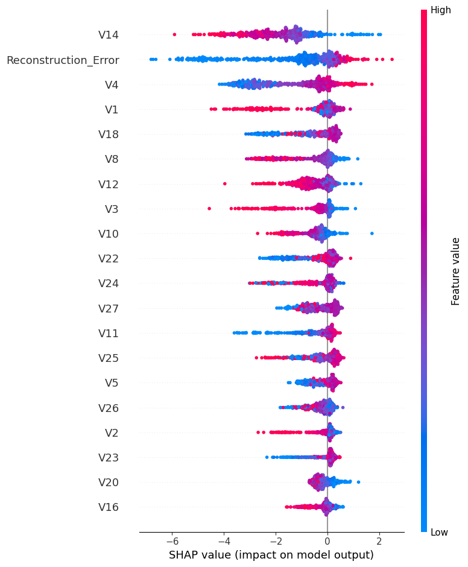

# 💳 Credit Card Fraud Detector

A hybrid machine learning system that detects fraudulent credit card transactions using an **autoencoder neural network**, **SMOTE** oversampling, and an **XGBoost + Random Forest ensemble**, with a **Streamlit dashboard** and **SHAP** explainability.

> Fraud is rare (about 0.17% of transactions in this dataset), so accuracy alone is misleading. This project focuses on **precision, recall, F1 and PR-AUC** for the fraud class.

---

## ✨ Features

- **Anomaly signal from an autoencoder:** a PyTorch autoencoder is trained *only on legitimate transactions*. Fraud is harder to reconstruct, so its reconstruction error becomes a strong fraud signal.
- **Hybrid features:** the reconstruction error is added as an extra (30th) feature to the 29 original features.
- **Imbalance handling:** SMOTE balances the training set.
- **Ensemble classifier:** XGBoost and Random Forest probabilities are averaged for the final fraud score.
- **Tuned decision threshold:** chosen from the precision-recall curve to maximise F1, instead of using a default 0.5.
- **Explainability:** SHAP summary plot shows which features drive predictions.
- **Interactive dashboard:** Streamlit app to explore results, load sample transactions, tweak feature values and see a prediction with an explanation.

---

## 🧠 How it works

```
creditcard.csv
      │
      ▼
 Preprocessing: drop Time, StandardScaler, stratified 80/20 split
      │
      ▼
 Autoencoder (29 → 16 → 8 → 16 → 29), trained on normal transactions only (50 epochs)
      │
      ▼
 Reconstruction error  ──►  added as the 30th feature
      │
      ▼
 SMOTE on the training set
      │
      ▼
 XGBoost + Random Forest  ──►  averaged fraud probability
      │
      ▼
 F1-optimal threshold  ──►  Fraud / Legitimate
```

---

## 🗂️ Project structure

```
Credit-Card-Fraud-Detector/
├── fraud_detection.py    # Trains the models, evaluates them, saves artifacts and the SHAP plot
├── app.py                # Streamlit dashboard
├── requirements.txt      # Python dependencies
├── shap_summary.png      # SHAP feature importance plot
└── README.md
```

Running `fraud_detection.py` also creates `scaler.pkl`, `xgb_model.pkl`, `rf_model.pkl` and `autoencoder.pth`, which the dashboard loads.

---

## 📦 Dataset

[Credit Card Fraud Detection (Kaggle, ULB)](https://www.kaggle.com/datasets/mlg-ulb/creditcardfraud)

- 284,807 transactions made by European cardholders in two days
- 492 frauds (0.17%)
- Features `V1`–`V28` are PCA-transformed, plus `Amount`, `Time` and the label `Class`

Download `creditcard.csv` and place it in the project root. It is not included in this repository because of its size.

---

## 🚀 Getting started

```bash
# 1. Clone the repo
git clone https://github.com/Sanjay-k7/Credit-Card-Fraud-Detector.git
cd Credit-Card-Fraud-Detector

# 2. (Optional) create a virtual environment
python -m venv venv
venv\Scripts\activate        # Windows
# source venv/bin/activate   # macOS / Linux

# 3. Install dependencies
pip install -r requirements.txt

# 4. Add creditcard.csv to the project folder, then train the models
python fraud_detection.py

# 5. Launch the dashboard
streamlit run app.py
```

---

## 📊 Results

Run `python fraud_detection.py` to print the classification report, ROC-AUC and PR-AUC on the held-out 20% test set. Add your own numbers below after running it:

| Metric (Fraud class) | Value |
|----------------------|-------|
| Precision            | _fill in from your run_ |
| Recall               | _fill in from your run_ |
| F1-score             | _fill in from your run_ |
| ROC-AUC              | _fill in from your run_ |
| PR-AUC               | _fill in from your run_ |



---

## 🛠️ Tech stack

- **Language:** Python
- **Deep learning:** PyTorch
- **ML:** scikit-learn, XGBoost, imbalanced-learn (SMOTE)
- **Explainability:** SHAP
- **Data and plots:** pandas, NumPy, Matplotlib
- **App:** Streamlit

---

## 🔭 Future improvements

- Compute the dashboard's performance metrics from saved test results instead of static values
- Add cross-validation and compare against more baselines
- Deploy the dashboard (Streamlit Community Cloud or Hugging Face Spaces)
- Add a real-time scoring API (FastAPI)

---

## 👥 Authors

- **K Sanjay** ([@Sanjay-k7](https://github.com/Sanjay-k7))
- **M Dattatreya**

---

## 📄 Disclaimer

This project is for educational purposes and is not a production fraud-detection system.
